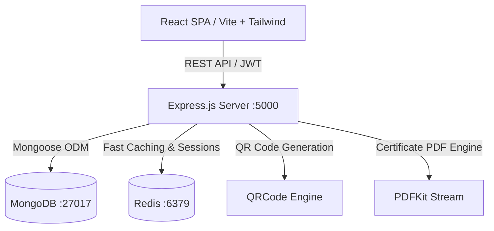

# CampusClub - Full-Stack College Club Management System

A multi-tenant college club and student extracurricular management platform. Built with **Node.js, Express, MongoDB, Redis, React, Vite, and Tailwind CSS**.

---

## 🏛️ Architecture Overview

The system provides multi-tenant role-based access control for Colleges, Clubs, and Students, complete with gamified participation, QR-based attendance tracking, automated PDF certificate generation, and an extracurricular portfolio builder.



---

## 🛠️ Technology Stack

| Layer | Technologies |
| :--- | :--- |
| **Frontend** | React 18, Vite, Tailwind CSS, React Router DOM v6, Axios, Recharts, Lucide React, Framer Motion |
| **Backend** | Node.js, Express.js, Mongoose, MongoDB, Redis (ioredis), JWT, bcryptjs, Zod, Multer, PDFKit, QRCode |
| **DevOps / Containers** | Docker, Docker Compose, Nginx |

---

## 👥 Seeded Demo Credentials

All seeded accounts use the password: `demo123`

| Role | Email | Password | Scope / Permissions |
| :--- | :--- | :--- | :--- |
| **Platform Admin** | `platform@campusclub.com` | `demo123` | Global system control, all colleges, audit logs |
| **College Admin** | `admin@nec.edu.in` | `demo123` | Full college oversight, approve clubs, college analytics |
| **Yoga Club Admin** | `yogaclub_admin@nec.edu.in` | `demo123` | Manage Yoga Club events, activities, attendance & certificates |
| **NSS Club Admin** | `nss_admin@nec.edu.in` | `demo123` | Manage NSS activities, sessions, and members |
| **Faculty Coordinator**| `faculty@nec.edu.in` | `demo123` | College-wide club review, audit participation |
| **Student** | `student1@nec.edu.in` | `demo123` | Instant registration, join clubs, earn points, get certificates |

---

## 🚀 Quick Start Guide

### Option 1: Local Development

#### Prerequisites
- Node.js >= 18.x
- MongoDB running locally on `localhost:27017`
- Redis running locally on `localhost:6379` (optional: backend automatically falls back to in-memory caching if Redis is offline)

#### 1. Backend Setup
```bash
cd backend
npm install
cp .env.example .env

# Seed initial database (College, 4 Clubs, Users, Events, Activities, Schedules)
npm run seed

# Start backend server (Port 5000)
npm run dev
```

#### 2. Frontend Setup
```bash
cd frontend
npm install

# Start Vite dev server (Port 5173)
npm run dev
```
Open your browser at `http://localhost:5173`.

---

### Option 2: Docker Compose

Launch the entire stack (MongoDB, Redis, Node Backend, React Nginx Frontend) with a single command:

```bash
# Build and run all services
docker-compose up --build -d

# Seed the database inside the backend container
docker-compose exec backend node src/utils/seed.js
```

- **Frontend Application**: `http://localhost:3000`
- **Backend API**: `http://localhost:5000/api`

---

## 🌟 Key Features

### 1. Instant Student Registration (Zero Approval Delay)
- New students select their college, department, and roll number during registration.
- Account is activated immediately upon submission, with JWT access and refresh tokens returned directly—no waiting for admin approval.

### 2. Multi-Tenant Role Isolation
- **Club Isolation**: Club administrators can only access and manage events, sessions, and members within their designated club.
- **College Multi-Tenancy**: Colleges operate in segregated environments; college admins only supervise clubs within their respective institution.

### 3. Non-Daily Recurring Activities
- Activities support recurring schedules including **Weekly** (e.g. Wednesday and Friday sessions) and **Bi-Weekly** cadences with designated start/end times and locations.

### 4. Dynamic Attendance Sessions & QR Check-In
- Club admins create live attendance sessions with dynamic QR codes.
- Supports QR scan verification, manual attendance toggle, and one-click CSV export of attendee lists.

### 5. Verified PDF Certificate Engine
- Automated certificate issuance with unique UUIDs.
- Embedded verification QR codes that link directly to the public `/verify-certificate/:uuid` page.
- Direct PDF download powered by backend streaming with `PDFKit`.

### 6. Student Extracurricular Portfolio
- Visual breakdown of points across clubs with Recharts radar and bar graphs.
- Direct exportable portfolio summary detailing badges, activity logs, and verified certificates.

---

## 📡 Core API Endpoints

### Authentication & Profiles
- `POST /api/auth/register/` - Direct student registration (auto-login)
- `POST /api/auth/login/` - User login with JWT token pair
- `GET /api/public-colleges/` - Public college dropdown for registration
- `GET /api/students/me/dashboard` - Student dashboard with real stats
- `GET /api/students/me/portfolio` - Comprehensive student extracurricular portfolio

### Clubs & Activities
- `GET /api/clubs/` - List all clubs (supports college filter)
- `GET /api/clubs/:id/` - Club profile and public statistics
- `POST /api/clubs/:id/join/` - Join club request
- `GET /api/clubs/:id/members/` - List club members (with CSV export)
- `POST /api/clubs/:id/activities/` - Create club activity with recurring schedules

### Events & Attendance
- `GET /api/events/` - List events
- `POST /api/events/` - Create event
- `POST /api/events/:id/register/` - Register for an event
- `POST /api/attendance/sessions/` - Create live QR attendance session
- `POST /api/attendance/verify-code/` - Mark attendance via QR code token
- `GET /api/attendance/sessions/:id/export/` - Download attendee CSV

### Certificates & Gamification
- `GET /api/gamification/certificates/` - List student's earned certificates
- `GET /api/gamification/certificates/:id/download/` - Stream verified PDF certificate
- `GET /api/gamification/certificates/verify/:uuid` - Public certificate verification
